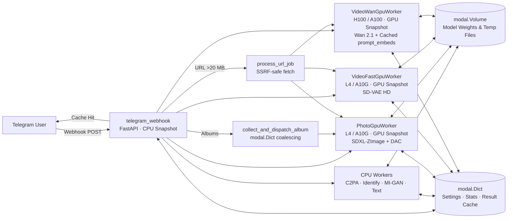

# NoMark — Serverless AI Watermark & Metadata Removal Telegram Bot

[](https://github.com/ByteFlipper-58/nomark-media-bot/actions/workflows/ci.yml)
[](LICENSE)
[](https://www.python.org/)
[](https://modal.com/)
[](nomark/presentation/i18n.py)

🇬🇧 **English** | 🇷🇺 **[Русский](README.ru.md)**

**NoMark** is a self-hosted, fully serverless Telegram bot powered by [remove-ai-watermarks](https://github.com/wiltodelta/remove-ai-watermarks) and [Modal](https://modal.com/). It strips **C2PA / EXIF / XMP metadata**, **invisible watermarks (SynthID, OpenAI, Meta)**, **visible corner logos**, and **hidden Unicode steganography** from photos, albums, videos, audio, ZIP archives, and text — with **$0/month idle cost** and **$30/month in free Modal Starter credits**.

---

## Features

### 6 Processing Modes (`/start`)
| Mode | What it does | Engine & Hardware |
| :--- | :--- | :--- |
| **✨ Full Clean HD** | Removes C2PA + SynthID at native resolution & FPS | Photos/Albums/ZIP: `SDXL-ZImage` (`L4`/`A10G`) · Video: `Wan 2.1 3D` (`H100`/`A100`) · Audio: `DAC` (`L4`) · Text: `CPU` |
| **⚡ Full Clean (Fast)** | Faster C2PA + SynthID cleaning for videos | Video: `SD-VAE HD` (native FPS, up to 1280px, `L4`/`A10G`) · Photos/Audio: same as HD |
| **🧹 Remove Visible Mark** | Auto-detects & erases Sora, Kling, Hailuo, Veo, Seedance, Doubao, Gemini logos + C2PA | `MI-GAN ONNX` (`CPU`) |
| **✂️ Erase Corner / Region** | Manual 6-corner button grid or custom `x,y,w,h` pixel box for photos & videos + C2PA | `MI-GAN ONNX` (`CPU`) |
| **🏷 Metadata Only (C2PA)** | Instant lossless removal of C2PA, EXIF, XMP, and hidden Unicode | `CPU` (no re-encoding) |
| **🔍 Inspect File** | Checks C2PA/AI metadata + 10-provider pixel-level AI source classifier | `classify-source` (`CPU`) |

### Usability & Controls
- **Bilingual UI (🇬🇧 English & 🇷🇺 Russian)** with an interactive language picker on first `/start` and instant switching in `/settings`.
- **Post-Result Quick Actions** directly under every cleaned file: retry video `Softer` / `Balanced` / `Strong` without re-uploading, `Full Clean (SynthID)` photo upgrade, `Verify Result`, `Recompute Fresh`, and `Menu`.
- **Smart Photo Source Profile** (`/settings`): `Auto` (reads C2PA) / `Gemini` (`0.50`) / `ChatGPT` (`0.15` minimal alteration) / `Meta AI` (`0.20`).
- **Realistic Camera EXIF** (`/settings`): optional `Off` / `iPhone 16 Pro` / `Sony A7 IV` EXIF injection (no GPS, zero AI tags).
- **Telegram Albums (`media_group_id`) & ZIP Batches**: multi-photo gallery uploads and ZIPs (up to 40 photos) coalesce onto a single warm GPU container.
- **Large Files (>20 MB)**: paste a Google Drive, Dropbox, or direct link (up to 250 MB). Outputs >50 MB are delivered via a temporary 1-hour Modal download link.
- **Monthly Usage Tracker & Auto Budget Guard (`/stats`)**: warns at `~$24` and auto-pauses GPU jobs at `~$27` of the `$30/mo` free tier (free CPU modes keep running; toggleable in `/stats`).

### Performance & Cold-Start Optimizations (Zero Quality Loss)
- **Modal CPU & GPU Memory Snapshots**: preloads Python imports and CUDA weights (`SDXL + ControlNet`, `SD-VAE`, `Wan 2.1`) into snapshots for fast scale-from-zero wakeups while costing `$0/mo` idle.
- **Wan 2.1 Prompt Embedding Cache**: caches the static `prompt_embeds` tensor on `modal.Volume`, skipping the **9.4 GB UMT5-XXL** encoder and CPU prompt encoding on every cold start (bit-for-bit identical output, ~7× faster startup).
- **Offline-First Volume Loading**: loads models directly from `/mnt/models/hf/hub` (`HF_HUB_OFFLINE=1` / `local_files_only=True`) with automatic online fallback on first download.
- **Instant Result Cache**: repeat uploads with identical `file_unique_id` + settings return instantly in `<1s` and `$0 GPU` via Telegram's `file_id` (with a `Recompute Fresh` button).
- **CUDA TF32 + `ffmpeg veryfast crf 16` + `@modal.concurrent` + On-Demand `🔥 Warm up GPU`**.

---

## Architecture



### Clean Architecture & Async Design
- **`nomark/domain/`**: Pure immutable models (`UserSettings`, `MediaItem`), deterministic business policies, and async Port Protocols (`StateStore`, `TelegramGateway`, `JobDispatcher`).
- **`nomark/presentation/`**: Bilingual RU/EN `i18n`, Telegram inline keyboards, and HTML views/reports.
- **`nomark/application/`**: Non-blocking async use-cases (`WebhookService`, `AlbumService`) powered by `asyncio.gather` and fully testable with in-memory fakes.
- **`nomark/infrastructure/`**: Keep-alive pooled `AsyncTelegramClient` / `SyncTelegramClient`, SSRF-safe media I/O, offline-first ML loaders + Wan 2.1 `prompt_embeds` cache, Modal Dict/Volume adapters, and CPU/GPU pipelines.
- **`modal_app.py`**: Thin Modal Composition Root wiring container images, CPU/GPU snapshots, secrets, and worker entrypoints.

---

## Quickstart (3 Minutes)

### Prerequisites
1. A Telegram Bot token from [@BotFather](https://t.me/BotFather).
2. A free [Modal](https://modal.com/) account (Starter plan includes **$30/month free compute credits**, no charges while idle).
3. Python 3.12+ (or [uv](https://docs.astral.sh/uv/)).

### Deploy on Windows (PowerShell)
```powershell
git clone https://github.com/ByteFlipper-58/nomark-media-bot.git
cd nomark-media-bot
powershell -ExecutionPolicy Bypass -File .\deploy.ps1
```

### Deploy on Linux / macOS
```bash
git clone https://github.com/ByteFlipper-58/nomark-media-bot.git
cd nomark-media-bot
chmod +x deploy.sh
./deploy.sh
```

> **Security Warning:** Always set `ALLOWED_USER_IDS` (your numeric Telegram user ID from `@userinfobot`, comma-separated for multiple users) during deployment. Leaving it empty makes your bot public, allowing anyone who discovers your bot handle to consume your Modal GPU credits.

### Updating After Edits & Viewing Logs
```bash
# Redeploy code changes (~5 seconds once images are cached)
modal deploy modal_app.py

# View recent logs
modal app logs raiw-telegram-bot --timestamps --tail 80
```

### Optional Environment Overrides
You can customize Modal resource names and branding before running `modal deploy`:
| Variable | Default | Description |
| :--- | :--- | :--- |
| `NOMARK_BOT_NAME` | `NoMark` | Bot display name in Telegram messages |
| `NOMARK_APP_NAME` | `raiw-telegram-bot` | Modal App name |
| `NOMARK_SECRET_NAME` | `raiw-bot-secrets` | Modal Secret name |
| `NOMARK_VOLUME_NAME` | `raiw-model-cache` | Persistent Modal Volume for weights |
| `NOMARK_STATE_DICT_NAME` | `raiw-bot-state` | Modal Dict for settings, stats & result cache |
| `NOMARK_ALBUM_DICT_NAME` | `raiw-bot-albums` | Modal Dict for album coalescing |

---

## Estimated Modal Costs (Starter Free Tier: $30/month)

| Workload | Hardware | Typical Time | Est. Cost per Run |
| :--- | :--- | :--- | :--- |
| Idle (24/7) | Scale-to-zero | — | **$0.00 / mo** |
| C2PA / Identify / Text / MI-GAN Erase | CPU (4 vCPU) | 1–8 s | ~$0.0002 |
| Photo Clean (`SDXL-ZImage`) | `L4` / `A10G` | 12–25 s (warm) | ~$0.005 |
| Fast Video Clean (`SD-VAE HD`) | `L4` / `A10G` | 20–45 s | ~$0.01 |
| HD Video Clean (`Wan 2.1 3D`) | `H100` / `A100` | 30–90 s | ~$0.04–$0.10 |
| Repeat File (Cache Hit) | Webhook CPU | < 1 s | **$0.00** |

The built-in **Budget Guard** (`/stats`) tracks estimated monthly GPU time and automatically pauses GPU workers at `$27` so you stay safely within Modal's `$30/mo` free credits.

---

## Running Tests

```bash
python -m unittest discover -s tests -v
```

---

## Credits, Licenses & Responsible Use

- Built on top of [**remove-ai-watermarks**](https://github.com/wiltodelta/remove-ai-watermarks) (Apache-2.0). All core provenance detection, metadata stripping, inpainting, and invisible watermark removal engines belong to the upstream project and its authors.
- Pretrained model weights downloaded at runtime (`SDXL`, `ControlNet`, `Z-Image`, `SAM`, `Wan 2.1`, `SD-VAE`, `MI-GAN`, `DAC`) are subject to their respective upstream model licenses.
- This project is licensed under the [MIT License](LICENSE).
- **Responsible Use:** NoMark is intended for privacy protection, metadata hygiene, personal creative workflows, and watermark robustness research. Do not use it for impersonation, fraud, disinformation, or violating platform terms of service or applicable laws.
